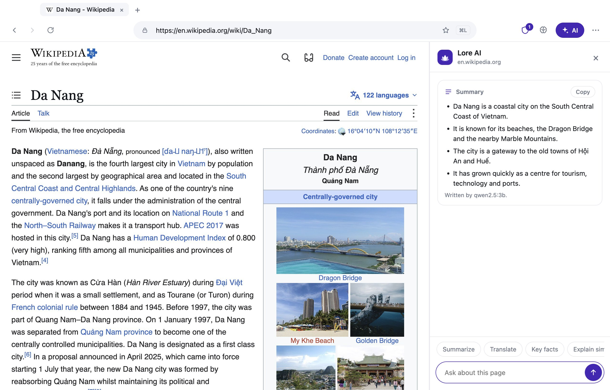

<p align="center">
  
</p>

<h1 align="center">Lore</h1>

<p align="center"><b>The browser that remembers you. Only you.</b></p>

<p align="center">
  <a href="https://github.com/tevo-web/lore/actions/workflows/ci.yml"></a>
  <a href="LICENSE"></a>
  <a href="https://github.com/tevo-web/lore/releases/latest"></a>
</p>

<p align="center">
  <a href="https://tevo-web.github.io/lore/">Website</a> ·
  <a href="https://github.com/tevo-web/lore/releases/latest">Download</a> ·
  <a href="README.vi.md">Tiếng Việt</a> ·
  <a href="CONTRIBUTING.md">Contribute</a>
</p>

Lore is a private, AI-assisted browser. You type what you need into one bar, and Lore answers first (with sources), helps you write and plan, and remembers what you read, **on your own computer and nowhere else**.

> **Status: early prototype.** The desktop app (macOS and Windows) works and is tested, but it is version 0.x, the installers are not code-signed, and several things in the roadmap do not exist yet. [What works and what does not](#what-works-and-what-does-not) is listed below, without spin.

<p align="center">
  
</p>

## Download

Get the latest installer from **[Releases](https://github.com/tevo-web/lore/releases/latest)**:

| Platform | File |
|---|---|
| macOS (Apple Silicon) | `Lore-mac-arm64.dmg` |
| macOS (Intel) | `Lore-mac-x64.dmg` |
| Windows 10/11 (64-bit) | `Lore-win-x64-setup.exe` |
| Linux (64-bit) | `Lore-linux-x64.AppImage` or `Lore-linux-x64.tar.gz` (built, but not tested on real Linux machines yet) |

The installers are **not signed** yet, so Windows SmartScreen and macOS Gatekeeper will warn you. On macOS, right-click the app and choose *Open* the first time. If you prefer not to trust a binary, [build it yourself](#build-from-source): it takes a few minutes.

## What it does

- **Answer first.** Ask a question in the address bar and get a short answer with its source. Lookups use Wikipedia and never invent prices or live data. Every sentence an AI model writes must point to the line it came from.
- **Private memory.** Pages you read are searchable by meaning ("the article about electric cars from last week"). The index is encrypted and stays on your computer. You can see, search, export and delete everything.
- **AI on every page.** A side panel summarizes, translates (in place, bilingual if you want), extracts key facts, explains in plain words and answers questions with the passage quoted. Right-click selected text or a text box for rewrite, fix, shorten, tone, translate, explain and summarize.
- **Tasks you can save.** Draft an email, a calendar event or a social post, or build your own task with fill-in fields. Lore writes the draft and opens it in a new tab (Gmail, Outlook, Yahoo, Google or Outlook Calendar, X, LinkedIn). **Lore never sends, posts or books anything.** You review and press the button in that service.
- **Tabs under control.** Tab groups, and one click to let Lore group your tabs by topic, close duplicates and file loose bookmarks into folders. You see the plan first and can undo. Saving a bookmark suggests a title, a folder and a note.
- **Safe reading.** Before a model reads a page, Lore drops hidden and invisible text and warns you when a page tries to give orders to an AI. See [docs/ai-safety.md](docs/ai-safety.md).
- **Private by default.** Ad and tracker blocking (EasyList, EasyPrivacy and a Vietnam list), third-party cookies blocked, Global Privacy Control, reduced fingerprinting, cookie-banner dismissal, a warning for look-alike bank and e-wallet sites, permissions that ask once, and private tabs that leave nothing behind.
- **Your AI, your choice.** Run a model on your machine through [Ollama](https://ollama.com), or bring your own key for any OpenAI-compatible service or Claude. Or turn AI off: everything that does not need a model still works.
- **The basics.** Bookmarks with a bar, a history page, find in page, a downloads manager, tabs that come back after a restart, pinned tabs, drag to reorder, reopen closed tabs, a lock indicator with a clear certificate warning, and a full right-click menu.
- **Profiles, split view and a gentle start.** Keep work and personal apart with profiles (own logins, tabs, memory, bookmarks), put two pages side by side, and on first run bring bookmarks and history over from Chrome, Edge, Brave, Vivaldi, Cốc Cốc or Firefox and make Lore your default browser.
- **Vietnamese and English.** The interface and the intent bar understand both, with or without diacritics.
- **Video download** for media you are allowed to save (plain files and HLS streams). Encrypted streams and platforms such as YouTube and Netflix are never offered.

## What works and what does not

Working today (desktop):

- Everything listed above, in English and Vietnamese, covered by unit tests (run in CI) and end-to-end suites (run locally).

Not done, so please do not count on it:

| Area | State |
|---|---|
| Android and iOS apps | Not started |
| Linux build | Packaged (AppImage and tar.gz) but never run on a real Linux machine |
| Shared Rust core (`core/`) | Placeholder only. The desktop app uses a JavaScript ad blocker for now |
| Agent workflows for real services | The confirm-before-acting engine and a browser driver exist and are tested against a local demo portal. **Paying a real bill or booking a real ticket is not implemented** |
| VPN | Not implemented |
| Sync across devices | Not implemented |
| Code signing, auto-update | Not set up |
| Signing in to Google inside Lore | May be refused by Google, which blocks embedded browsers. Lore keeps Electron's honest user agent and offers to open that page in your system browser |
| Extensions | Not supported |

## What leaves your computer

Lore has no analytics, no telemetry and no account. These are the only network requests it makes besides the pages you open:

| When | To | What is sent |
|---|---|---|
| You ask a plain question | `wikipedia.org` | The topic words |
| You search the web | `duckduckgo.com` | Your query (you opened a search) |
| Shortly after start and every few hours | `github.com` (the latest release) | Nothing but your IP address and the version number in the request. Turn it off in Settings > General |
| About once a week | `easylist.to`, `abpvn.com`, `raw.githubusercontent.com` | Nothing but your IP address (ad filter lists and the phishing domain list) |
| You use AI with a local model | Your Ollama (`localhost`) | The text you asked about, to your own machine |
| You use AI with a cloud key | The provider you configured | The text you asked about. Settings warn you which host will receive it, and every result states where the text was sent |
| You open a draft or share | Gmail, Outlook, Yahoo, X, LinkedIn, Google or Outlook Calendar | What you chose to open, in a normal tab |

Browsing history, page text and memory are never uploaded. Settings and memory are encrypted with your operating system's keychain.

## Build from source

You need **Node.js 22 or newer** and Git.

```bash
git clone https://github.com/tevo-web/lore.git
cd lore/desktop
npm ci
npm run filters     # downloads and compiles the bundled ad-block lists (needs internet)
npm start           # runs Lore
```

Tests:

```bash
npm test            # unit tests (fast)
npm run test:e2e    # end-to-end tests with a real Electron window; quit other Electron apps first
```

Installers:

```bash
npm run dist:mac    # dist/Lore-mac-<arch>.dmg (unsigned)
npm run dist:win    # dist/Lore-win-x64-setup.exe (unsigned)
npm run dist:linux  # dist/Lore-linux-x64.AppImage and .tar.gz
# Signed builds, for maintainers with certificates: see docs/release.md
```

To try AI with a model on your machine: install [Ollama](https://ollama.com), then in Lore open **Settings → AI model** and pick a model.

## Project layout

| Path | Contents |
|---|---|
| `desktop/` | The Electron app (macOS, Windows, Linux) |
| `desktop/src/` | Main process, router, memory, AI, tasks, privacy and UI pages |
| `desktop/test/` | Unit tests. `desktop/test-e2e/` has the Electron end-to-end suites |
| `core/` | Planned shared Rust core (ad blocking, downloads, storage) |
| `android/`, `ios/` | Planned mobile apps |
| `design/` | Icon source and HTML mockups |
| `docs/` | Engine decision, release process, third-party licences |
| `site/` | The landing page, published with GitHub Pages |

Useful reading: [Engine decision](docs/engine-spike.md), [Release process](docs/release.md), [Third-party components](docs/third-party.md).

## Contributing

Bug reports, translations, tests and pull requests are welcome. Please read [CONTRIBUTING.md](CONTRIBUTING.md) first, and report security issues privately as described in [SECURITY.md](SECURITY.md). Everyone taking part is expected to follow the [Code of Conduct](CODE_OF_CONDUCT.md).

Good first areas: more Vietnamese test sentences for the intent bar (`desktop/test/vn-eval.test.js`), new built-in tasks (`desktop/src/tasks.js`), translations (`desktop/src/ui/i18n.js`), site adapters for the agent, and a Linux build.

## License

[MIT](LICENSE) © 2026 Tevo. Third-party components keep their own licences: see [docs/third-party.md](docs/third-party.md).

Lore is built on [Electron](https://www.electronjs.org/) (Chromium), [@ghostery/adblocker](https://github.com/ghostery/adblocker), [Mozilla Readability](https://github.com/mozilla/readability), [EasyList](https://easylist.to) and [Phishing.Database](https://github.com/mitchellkrogza/Phishing.Database). Thank you to everyone who maintains them.
